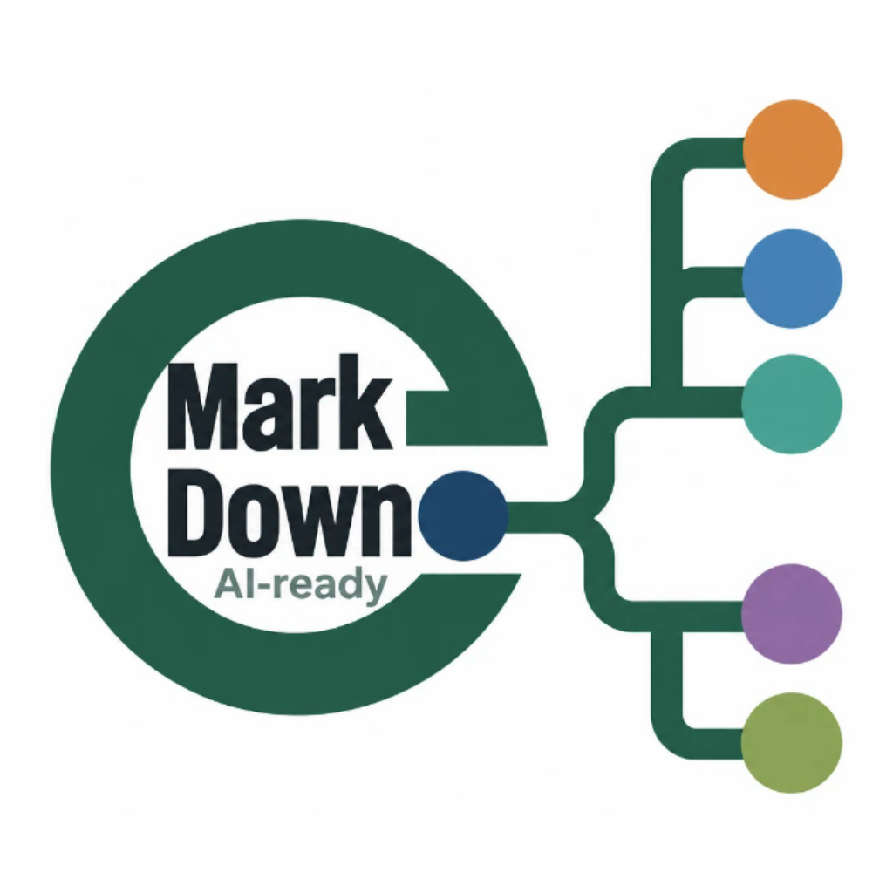

# EasyMindMap 브랜드 로고

> 2026-10-19 v4: 사용자 승인 AI-ready 브랜드 이미지.
> [`logo.svg`](./logo.svg)는 앱 원본 `apps/frontend/src/assets/brand-logo.svg`와 동일 바이트의 문서용 사본이다.
> 주 로고는 승인된 래스터 이미지를 포함한 자기완결 SVG 래퍼이며, 순수 벡터 도안이 아니다. 이전 v3 도안은 현재 브랜드 자산으로 사용하지 않는다.

## 자산 파일

| 파일 | 형식 | 용도 |
|---|---|---|
| `logo.svg` | 1024×1024 viewBox, WebP 래스터 내장 SVG | 앱 원본과 동일한 승인 주 로고 |
| `logo.png` | 래스터 1024×1024 | 승인 주 로고의 PNG 사본, 문서·홍보·SVG 미지원 환경 |
| `logo-256.png` | 래스터 256×256 | 승인 주 로고의 축소 PNG 사본 |

PNG 두 종은 승인된 정사각 서비스 이미지에서 만든 사본이다. SVG의 내장 이미지는 WebP 압축본이므로 PNG와 픽셀 단위 동일성을 주장하지 않는다.

## 도안과 사용 구분

- 주 로고는 Markdown에서 마인드맵으로 이어지는 브랜드 이미지와 AI-ready 표기를 담는다. AI-ready는 정확도 인증이나 자동 학습효과 보장이 아니다.
- `apps/frontend/src/assets/favicon.svg`는 작은 크기에서 쓰는 별도의 텍스트 없는 간결한 마크다. 주 로고를 작은 슬롯에 축소해 쓰지 않는다.
- `I.Logo`는 기본 22px을 포함해 48px 미만에서 간결한 마크를 쓰며, 48px 이상에서는 주 로고를 쓴다. 로그인 화면의 72px 로고는 주 로고를 유지한다.

## 사용처

| 위치 | 참조 방식 |
|---|---|
| 앱 주 로고 원본 | `apps/frontend/src/assets/brand-logo.svg` |
| 문서·README | `docs/assets/brand/logo.svg`, 앱 주 로고 원본과 동일 바이트 |
| 브라우저 탭 파비콘 | `apps/frontend/index.html` → `/src/assets/favicon.svg` |
| 앱 로고 컴포넌트 | `components/icons/index.tsx`의 `I.Logo`, 크기에 따라 주 로고/간결한 마크 선택 |
| 내보낸 HTML 뷰어 헤더·파비콘 | `export/exportHtml.ts`의 `LOGO_SVG` → `favicon.svg?raw` 내장 |

## 교체 절차

1. 승인된 주 로고 SVG를 앱 원본에 적용하고 문서의 `logo.svg`를 동일 바이트로 동기화한다.
2. 승인된 정사각 래스터 이미지에서 `logo.png`와 `logo-256.png`를 갱신한다.
3. 작은 슬롯용 간결한 마크가 바뀌면 `favicon.svg`를 별도로 갱신한다.
4. 주 로고와 간결한 마크의 역할을 유지하고, 래스터 내장 SVG를 순수 벡터라고 설명하지 않는다.
